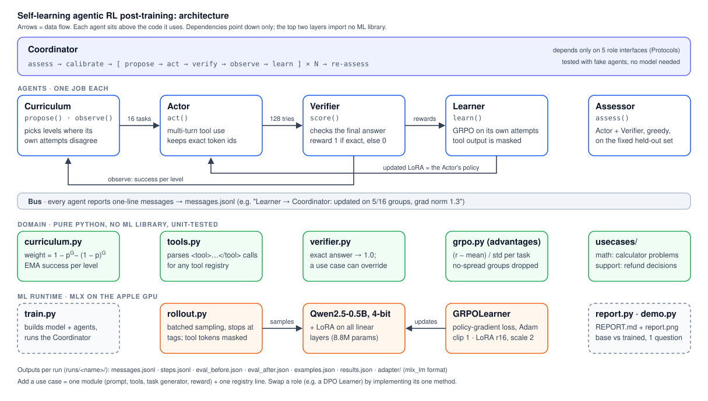
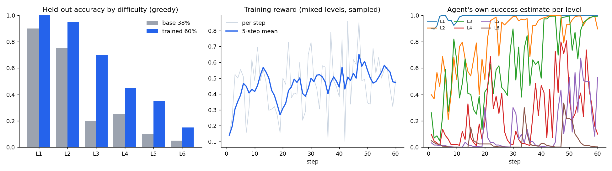
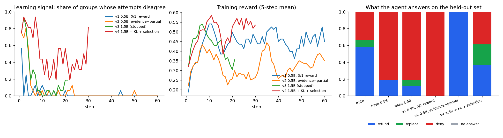

# Agentic Post-Training Framework

[](https://www.python.org/downloads/)
[](LICENSE)
[](https://colab.research.google.com/github/sugeerth/agentic-post-training/blob/main/notebooks/agentic_post_training_colab.ipynb)
[](https://sugeerth.github.io/agentic-post-training/)

**Orchestrating LLM alignment through autonomous agent collaboration.**

A modular framework where specialized AI agents coordinate to execute post-training pipelines — from technique selection through training, optimization, and evaluation. Agents communicate via a structured message bus, making the entire process observable and debuggable.

## Self-learning agentic RL post-training (real training, runs on a Mac)

**Live:** the [web demo's first tab](https://sugeerth.github.io/agentic-post-training/demo.html) replays every held-out problem (base vs trained) and the agents' real message log.

A small model teaches itself to use tools, with **no human labels**: it tests itself, picks what to practise,
attempts problems with its tools, has its answers checked, and updates its own weights with GRPO. Two use cases run
on the same agents: **word problems with a calculator** (37.5% → 60.0% held-out) and **a customer-support agent that
decides refunds** (43.3% → 60.0%, after three honest failed runs). Unlike the simulated pipeline further down,
**every number in this section is measured.**



| Agent | One job | File |
|---|---|---|
| Assessor | greedy accuracy on a fixed held-out set, per difficulty level | `selflearn/agents.py` |
| Curriculum | samples levels with probability ∝ `1 − pᴳ − (1 − p)ᴳ`: the chance a group of its own attempts disagrees, i.e. carries GRPO signal | `selflearn/curriculum.py` |
| Actor | multi-turn tool use: `<calc>…</calc>` → `<result>…</result>` → `<answer>…</answer>` | `selflearn/rollout.py`, `selflearn/tools.py` |
| Verifier | binary, exact reward from the final answer | `selflearn/verifier.py` |
| Learner | GRPO: group-relative advantages, groups with no spread dropped, loss only on model-written tokens | `selflearn/grpo.py` |
| Designer | owns the environment: audits it for shortcuts before training, switches to a variant where doing the task beats every shortcut (or refuses to train), watches each batch for reward hacking ([below](#rl-environment-design-a-designer-agent-that-audits-the-environment-before-training-on-it)) | `selflearn/env.py`, `selflearn/audit.py` |

Agents report on a small message bus (`selflearn/bus.py`, logged to `messages.jsonl`):

```
[19:50:55] Coordinator → all         model Qwen2.5-0.5B-Instruct-4bit, LoRA 8.8M params, 60 steps
[19:51:13]   Assessor → Coordinator base: held-out accuracy 37.5% (L1 90% L2 75% L3 20% L4 25% L5 10% L6 5%)
[19:51:13] Curriculum → Coordinator practice weights from the baseline: L1 14% L2 22% L3 20% L4 22% L5 14% L6 9%
[19:51:13] Curriculum → Actor       practise levels [2, 2, 2, 2, 3, 3, 3, 3, 3, 4, 4, 4, 4, 5, 5, 5]
[19:51:36]      Actor → Verifier    128 attempts, 0.9 tool calls each
[19:51:36]   Verifier → Learner     mean reward 0.14
[19:51:52]    Learner → Coordinator updated on 6/16 groups, grad norm 0.85
   ...
[20:27:05]   Assessor → Coordinator trained: held-out accuracy 60.0% (L1 100% L2 95% L3 70% L4 45% L5 35% L6 15%)
[20:27:05] Coordinator → all         done: 37.5% -> 60.0% held-out, fixed 29, broke 2 | runs/qwen0.5b-selflearn
```

### Use case 1: word problems with a calculator (Qwen2.5-0.5B-Instruct-4bit, 60 steps, Apple M3 Pro, 36 minutes)

Same 120 held-out problems before and after, greedy decoding:

| | base | after self-learning |
|---|---|---|
| **accuracy** | **37.5%** | **60.0%** |
| level 1 | 90% | 100% |
| level 2 | 75% | 95% |
| level 3 | 20% | 70% |
| level 4 | 25% | 45% |
| level 5 | 10% | 35% |
| level 6 | 5% | 15% |
| used the calculator | 95% | 100% |

Fixed **29** problems, broke **2**. Full report: [`runs/qwen0.5b-selflearn/REPORT.md`](runs/qwen0.5b-selflearn/REPORT.md)



**Example (level 6, answer 20864).** A farm has 1815 eggs. It gives away 1306 eggs. It receives 34 baskets with 16 eggs each. It gets 640 more eggs. It gives away 389 eggs. Then the number of eggs at the farm quadruples. Then the number of eggs at the farm quadruples. How many eggs does the farm have now?

```
BASE MODEL (wrong)
<calc>1815 - 1306 + 34 * 16 + 640 - 389</calc>

<result>1304</result>
<answer>1304</answer>

AFTER SELF-LEARNING (right)
<calc>1815 - 1306 + 34 * 16 + 640 - 389</calc>

<result>1304</result>
<calc>1304 * 4</calc>

<result>5216</result>
<calc>5216 * 4</calc>

<result>20864</result>
<answer>20864</answer>
```

**What it learned.** Calculator calls per problem went from 0.97 to 2.50. The base model often answers after its first
calculation and drops the remaining steps; after self-learning it keeps calling the tool until every step is done.

**Live check on a new question** (in neither the training data nor the held-out set; answer 5110):

```
$ python3 -m selflearn.demo --adapter runs/qwen0.5b-selflearn/adapter --answer 5110 --question "A bakery has 2400 cookies.
  It gives away 950 cookies. It receives 25 trays with 36 cookies each. Then the number of cookies at the bakery doubles.
  It gets 410 more cookies. How many cookies does the bakery have now?"

=== BASE MODEL  -> wrong                       (skipped the "doubles" step)
<calc>2400 - 950 + 25 * 36 + 410</calc>  <result>2760</result>  <answer>2760</answer>

=== AFTER SELF-LEARNING  -> correct
<calc>2400 - 950 + 25 * 36</calc>  <result>2350</result>
<calc>2350 * 2 + 410</calc>  <result>5110</result>
<calc>5110</calc>  <result>5110</result>  <answer>5110</answer>      (one redundant check, a habit it picked up)
```

**Limits.** One seed, one small model, synthetic word problems. With 120 held-out problems each accuracy has about
±4.5 points of sampling error, so the 22.5-point gain is well outside noise; other tasks need their own runs.

### Use case 2: a customer-support agent that decides refunds

Same agents, same loop, a different `UseCase` (`selflearn/usecases/support.py`). A customer writes in about an order;
the agent looks it up with an `<order>` tool, does arithmetic with `<calc>`, applies a four-rule refund policy, and
answers `refund AMOUNT`, `replace` or `deny`. A reference implementation of the policy scores the decision, so there
are still no human labels. Levels go from a lost package (look up, add price + shipping) to cases where the
customer's message contradicts the order record (the record wins). Levels 3-6 are built about half refund, half deny,
and a test enforces it, so a constant answer cannot score well.

**What happened, honestly.** The first three runs collapsed onto a single answer, which is the classic way RL on a
small model fails:

| run | change | held-out accuracy | what the agent learned |
|---|---|---|---|
| v1 | 0.5B, plain 0/1 reward | 31.1% → 33.3% | answer **"deny" to everything**, without looking anything up (33.3% = the share of deny cases) |
| v2 | + no credit without a lookup, 0.5 for the right action with a wrong amount | 31.1% → 24.4% | look every order up, then answer **"refund" to everything** (partial credit made it pay) |
| v3 | 1.5B model, same reward | stopped at step 21 | attempts stopped disagreeing after step 9 (0-3 of 16 groups carried signal), success estimates falling |
| v4 | 1.5B + KL anchor to the base model, half the learning rate, best checkpoint chosen on a validation set | 43.3% → **60.0%** | a real policy: answers spread over refund / replace / deny, every order looked up |



The left panel is the tell: the share of groups whose attempts disagree (the only groups GRPO can learn from) falls
to about zero within 5-10 steps in the collapsed runs. The right panel shows what the agent ends up answering.

Fixes that are now part of the framework, all optional flags:
- `--kl 0.04`: a KL penalty to the base model, computed with the same weights by setting every LoRA scale to 0 (no
  second copy of the model).
- `--select-every 5`: a Selector agent scores a separate validation set every 5 steps and restores the best
  checkpoint before the final test, so a late collapse cannot ship. Step 0 (the untouched model) is a candidate, so
  the result is never worse on validation than where it started.
- The support reward: no decision without a successful lookup (policy rule 1), partial credit for the right action.

**Result (v4): Qwen2.5-1.5B-Instruct-4bit, 30 steps, Apple M3 Pro, 108 minutes.** Same 90 held-out cases, greedy:

| | base | after self-learning |
|---|---|---|
| **accuracy** | **43.3%** | **60.0%** |
| level 1 (lost package) | 47% | 100% |
| level 2 (damaged item) | 27% | 53% |
| level 3 (changed mind, 10% fee) | 27% | 27% |
| level 4 (gold member / final sale) | 67% | 67% |
| level 5 (in-transit timing) | 47% | 40% |
| level 6 (message contradicts the record) | 47% | 73% |

Fixed 25, broke 10 (paired McNemar test p ≈ 0.01). Validation accuracy rose 50.0% → 69.4% and the Selector kept
step 30. It chose "refund" on 29 of the 52 refund cases (base: 11); the base model said "deny" to 73 of 90 cases.
Full report: [`runs/support-qwen1.5b/REPORT.md`](runs/support-qwen1.5b/REPORT.md)

**Live check on fresh cases** (`python3 -m selflearn.demo --adapter runs/support-qwen1.5b/adapter --level 6 --seed 99`):

```
Customer: Order A728557: I don't need the Coffee Maker anymore, can I get my money back? I'm a gold member, so no fee please.
(correct: refund 73.24)

=== BASE MODEL  -> wrong
<order>A728557</order>  <result>... price: 81.38 | ... delivered 7 days ago | ... member: standard</result>
<answer>deny</answer>

=== AFTER SELF-LEARNING  -> correct          (trusts the record, not the claim: standard member, 10% fee)
<order>A728557</order>  <result>... price: 81.38 | ... delivered 7 days ago | ... member: standard</result>
<calc>81.38 - (81.38 * 0.10)</calc>  <result>73.242</result>  <answer>refund 73.24</answer>
```

Seeds 99, 100 and 101 were all run: the trained agent got 3 of 3, the base model 1 of 3.

**What is still wrong.** It now over-uses "replace" (14 of its 22 replace answers are wrong), level 5 timing rules got
slightly worse, and levels 3-4 did not move. One seed, 90 held-out cases: about ±5 points of sampling error per accuracy.

### Run it

```bash
pip install mlx-lm matplotlib                     # Apple silicon
python3 -m selflearn.train --smoke                # 1 minute: checks the plumbing
python3 -m selflearn.train --steps 60             # use case 1 (math), the run above
python3 -m selflearn.train --usecase support --model mlx-community/Qwen2.5-1.5B-Instruct-4bit \
    --steps 30 --kl 0.04 --lr 1e-5 --select-every 5 --designer 0   # use case 2 (support), v4 above
python3 -m selflearn.audit --usecase support      # environment audit: oracle + shortcut probes, no model needed
python3 -m selflearn.audit --usecase support --policy runs/support-qwen1.5b   # + verdict vs that agent, variants
python3 -m selflearn.compare runs/a runs/b --out runs.png   # learning signal + decision mix across runs
python3 -m selflearn.report runs/<run>            # REPORT.md + report.png
python3 -m selflearn.demo --adapter runs/<run>/adapter --question "A farm has 120 eggs. ..."
python3 -m selflearn.publish runs/<run>           # updates the "Self-Learning (real run)" tab of the web demo
python3 -m pytest tests/test_selflearn.py         # 18 fast tests, no model needed
```

Design notes: the Coordinator imports no ML library and is tested with fake agents; tools are a registry
(add one entry to add a tool); LoRA scale 2 (mlx's default of 20 collapsed the policy in one step in a smoke test);
one on-policy update per batch, so no PPO clipping or KL term is needed at this scale.

## Architecture

```
                    ┌─────────────────┐
                    │   Coordinator   │
                    │     Agent       │
                    └────────┬────────┘
                             │ Message Bus
              ┌──────────────┼──────────────┐
              │              │              │
     ┌────────▼───────┐ ┌───▼──────────┐ ┌─▼──────────────┐
     │  Training Agent │ │ Optimization │ │  Evaluation    │
     │                 │ │    Agent     │ │    Agent       │
     │ PPO,GRPO,DPO,  │ │ Quantization │ │ MMLU,MT-Bench  │
     │ SPO,RLHF,...   │ │ Pruning,     │ │ HumanEval,...  │
     │                 │ │ Distillation │ │                │
     └─────────────────┘ └──────────────┘ └────────────────┘
```

## Supported Techniques

| Priority | Technique | Description | Key Advantage |
|----------|-----------|-------------|---------------|
| 1 | **PPO** | Proximal Policy Optimization | Stable RL with clipped objectives |
| 1 | **GRPO** | Group Relative Policy Opt. | No value model needed (DeepSeek-R1) |
| 1 | **DPO** | Direct Preference Opt. | Simple, no reward model needed |
| 1 | **SPO** | Self-Play Optimization | Iterative self-improvement |
| 1 | **RLHF** | RL from Human Feedback | Full proven pipeline (InstructGPT) |
| 2 | **KTO** | Kahneman-Tversky Opt. | Works with binary feedback |
| 2 | **ORPO** | Odds Ratio Preference Opt. | Combined SFT + alignment |
| 2 | **RLAIF** | RL from AI Feedback | No human labelers needed |
| 2 | **SPIN** | Self-Play Fine-Tuning | Only needs SFT data |
| 2 | **SimPO** | Simple Preference Opt. | Reference-free, length-normalized |
| 3 | **IPO** | Identity Preference Opt. | Regularized DPO variant |

## Demos

| Demo | Platform | Link |
|------|----------|------|
| **Interactive Browser Demo** | GitHub Pages | [Launch Demo](https://sugeerth.github.io/agentic-post-training/demo.html) |
| **Full Training on A100** | Google Colab | [](https://colab.research.google.com/github/sugeerth/agentic-post-training/blob/main/notebooks/agentic_post_training_colab.ipynb) |
| **Multi-GPU Training (T4x2)** | Kaggle | [Open in Kaggle](https://www.kaggle.com/kernels/welcome?src=https://github.com/sugeerth/agentic-post-training/blob/main/notebooks/agentic_post_training_kaggle_t4x2.ipynb) |
| **Agent Communication** | Local terminal | `python3 examples/agent_demo.py` |

## Quick Start

```bash
# Install
pip install -e .

# Run the agent demo (no GPU needed)
python3 examples/agent_demo.py

# Run full pipeline
python3 examples/run_pipeline.py --technique grpo --model gpt2 --epochs 3

# Compare techniques
python3 examples/compare_techniques.py --techniques ppo dpo grpo
```

### Python API

```python
import asyncio
from pipeline.config import PipelineConfig
from pipeline.pipeline import AgenticPipeline

config = PipelineConfig(
    technique="grpo",
    model_name="gpt2",
    epochs=3,
    quantization="gptq",
    benchmarks=["mmlu", "mt_bench", "humaneval"],
)

pipeline = AgenticPipeline(config)
results = asyncio.run(pipeline.run())
```

## Pipeline Stages

1. **Data Preparation** — Validate and preprocess training data
2. **Technique Selection** — Choose optimal technique for the task
3. **Training** — Execute post-training with the selected technique
4. **Optimization** — Quantize (GPTQ/AWQ/GGUF), prune, or distill
5. **Evaluation** — Benchmark on MMLU, MT-Bench, HumanEval, etc.

## Agent Communication

Agents communicate via a structured message bus. Watch them coordinate in real-time:

```
[14:23:01] 🔗 Coordinator → broadcast: Starting stage: training
[14:23:01] 📊 Trainer → Coordinator: Loading model: gpt2
[14:23:02] 📊 Trainer → broadcast: Beginning GRPO training for 3 epochs
[14:23:02] 📊 Trainer → broadcast: Epoch 1/3 | Loss: 1.8432 | Reward: 0.5700
[14:23:03] 📊 Trainer → broadcast: Epoch 2/3 | Loss: 0.9821 | Reward: 0.7900
[14:23:03] ✅ Trainer → Coordinator: Training complete! Final loss: 0.5513
[14:23:04] ⚡ Optimizer → broadcast: Starting GPTQ quantization (4-bit)
[14:23:04] ✅ Optimizer → Coordinator: Quantization complete: 8.0x compression
[14:23:05] 📈 Evaluator → broadcast: Starting evaluation suite: mmlu, mt_bench
```

## Configuration Presets

```python
from pipeline.config import PipelineConfig

# Quick DPO alignment
config = PipelineConfig.preset("quick_dpo")

# Full RLHF pipeline
config = PipelineConfig.preset("full_rlhf")

# GRPO with quantization
config = PipelineConfig.preset("efficient_grpo")

# Production deployment
config = PipelineConfig.preset("production")
```

## Optimization

| Method | Compression | Quality | Use Case |
|--------|-------------|---------|----------|
| GPTQ | 8x | ~99% | Production inference |
| AWQ | 8x | ~99.5% | Best quality at 4-bit |
| GGUF | 8x | ~98% | llama.cpp deployment |
| NF4 | 8x | ~99% | QLoRA training |
| INT8 | 4x | ~99.9% | Minimal quality loss |

## Tests

```bash
python3 -m pytest tests/ -v
```

## License

Apache 2.0 — see [LICENSE](LICENSE).
