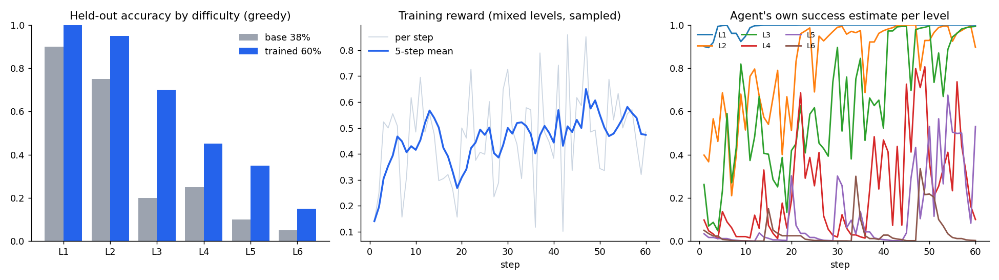

# Self-learning agentic RL: mlx-community/Qwen2.5-0.5B-Instruct-4bit, 60 steps

Held-out set: 120 problems (fixed seed), greedy decoding, same questions before and after.

| | base | trained |
|---|---|---|
| **accuracy** | **37.5%** | **60.0%** |
| L1 | 90% | 100% |
| L2 | 75% | 95% |
| L3 | 20% | 70% |
| L4 | 25% | 45% |
| L5 | 10% | 35% |
| L6 | 5% | 15% |
| used the calculator | 95% | 100% |
| calls per problem | 0.97 | 2.50 |

Problems fixed by training: **29**; problems broken: **2**.



## Example 1 (level 6, answer 20864)

> A farm has 1815 eggs. It gives away 1306 eggs. It receives 34 baskets with 16 eggs each. It gets 640 more eggs. It gives away 389 eggs. Then the number of eggs at the farm quadruples. Then the number of eggs at the farm quadruples. How many eggs does the farm have now?

**Base model** (reward 0):

```
<calc>1815 - 1306 + 34 * 16 + 640 - 389</calc>

<result>1304</result>
<answer>1304</answer>
```

**After self-learning** (reward 1):

```
<calc>1815 - 1306 + 34 * 16 + 640 - 389</calc>

<result>1304</result>
<calc>1304 * 4</calc>

<result>5216</result>
<calc>5216 * 4</calc>

<result>20864</result>
<answer>20864</answer>
```

## Example 2 (level 6, answer 13282)

> A farm has 1200 eggs. Then the number of eggs at the farm quadruples. It receives 31 baskets with 12 eggs each. It gives away 1775 eggs. It receives 39 baskets with 18 eggs each. Then the number of eggs at the farm triples. It gets 985 more eggs. How many eggs does the farm have now?

**Base model** (reward 0):

```
<calc>1200 * 4</calc>

<result>4800</result>
<answer>4800</answer>
```

**After self-learning** (reward 1):

```
<calc>1200 * 4 + 31 * 12 - 1775 + 39 * 18</calc>

<result>4099</result>
<calc>4099 * 3 + 985</calc>

<result>13282</result>
<answer>13282</answer>
```

## One it got worse on (level 4, answer 332)

> A library has 790 books. It gives away 51 books. Then the number of books at the library triples. It splits the books equally into 3 shelves and keeps only one of them. It gives away 407 books. How many books does the library have now?

```
<calc>790 - 51</calc>

<result>739</result>
<calc>739 * 3</calc>

<result>2217</result>
<calc>2217 - 407</calc>

<result>1810</result>
<calc>1810</calc>


<result>1810</result>
```
