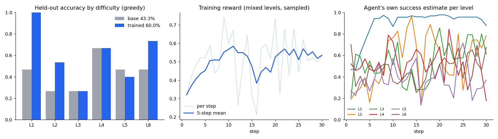

# Self-learning agentic RL (support): mlx-community/Qwen2.5-1.5B-Instruct-4bit, 30 steps

Held-out set: 90 problems (fixed seed), greedy decoding, same questions before and after.

| | base | trained |
|---|---|---|
| **accuracy** | **43.3%** | **60.0%** |
| L1 | 47% | 100% |
| L2 | 27% | 53% |
| L3 | 27% | 27% |
| L4 | 67% | 67% |
| L5 | 47% | 40% |
| L6 | 47% | 73% |
| used the calculator | 100% | 100% |
| calls per problem | 1.00 | 2.00 |

Problems fixed by training: **25**; problems broken: **10**.



## Example 1 (level 6, answer refund 290.37)

> Order A162854: I don't need the Wool Sweater anymore, can I get my money back? I'm a gold member, so no fee please.

**Base model** (reward 0):

```
<order>A162854</order>

<result>order A162854 | item: Wool Sweater | price: 322.63 | shipping: 0.00 | status: delivered | delivered 17 days ago | in stock: yes | final sale: no | member: standard</result>
<answer>deny</answer>
```

**After self-learning** (reward 1):

```
<order>A162854</order>

<result>order A162854 | item: Wool Sweater | price: 322.63 | shipping: 0.00 | status: delivered | delivered 17 days ago | in stock: yes | final sale: no | member: standard</result>
<calc>322.63 - (322.63 * 0.10)</calc>

<result>290.367</result>
<answer>refund 290.37</answer>
```

## Example 2 (level 6, answer refund 319.17)

> Order A402350: I don't need the Coffee Maker anymore, can I get my money back? I'm a gold member, so no fee please.

**Base model** (reward 0):

```
<order>A402350</order>

<result>order A402350 | item: Coffee Maker | price: 354.63 | shipping: 12.00 | status: delivered | delivered 25 days ago | in stock: yes | final sale: no | member: standard</result>
<answer>deny</answer>
```

**After self-learning** (reward 1):

```
<order>A402350</order>

<result>order A402350 | item: Coffee Maker | price: 354.63 | shipping: 12.00 | status: delivered | delivered 25 days ago | in stock: yes | final sale: no | member: standard</result>
<calc>354.63 - (354.63 * 0.10)</calc>

<result>319.167</result>
<answer>refund 319.17</answer>
```

## One it got worse on (level 2, answer refund 380.41)

> Hi, my Running Shoes from order A547012 came damaged. What can you do?

```
<order>A547012</order>

<result>order A547012 | item: Running Shoes | price: 380.41 | shipping: 12.00 | status: delivered | delivered 23 days ago | in stock: no | final sale: no | member: standard</result>
<calc>380.41 + 12.00</calc>

<result>392.41</result>
<answer>replace</answer>
```
